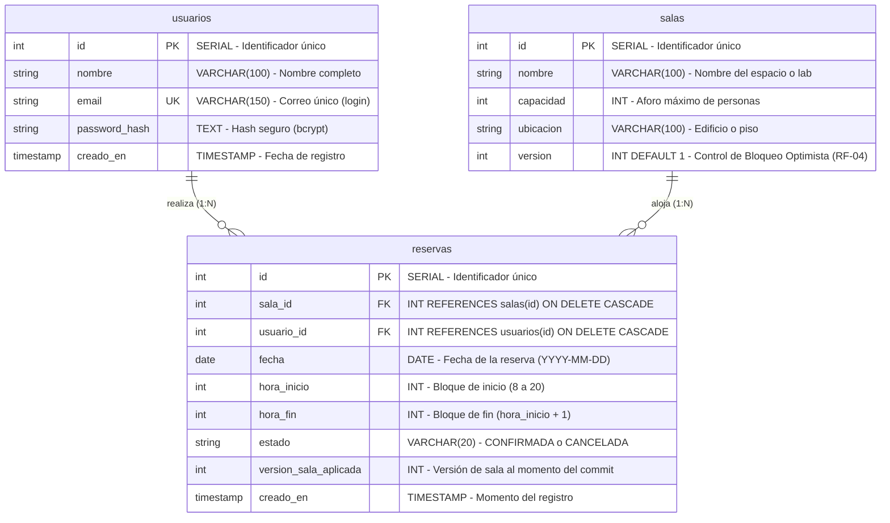

# 🏢 Sistema de Reservas para Laboratorios y Salas de Estudio

> **Proyecto Académico:** Demostración de Control de Concurrencia Optimista, Transacciones ACID en SQL Puro, WebSockets en Tiempo Real, Caché y Colas en Segundo Plano con Docker.

---

## 1. Resumen de Arquitectura y Stack del Proyecto Completo

El sistema está orquestado en **4 contenedores independientes** mediante Docker Compose, cada uno con cuota asignada de **1 GB de RAM**:

```mermaid
flowchart TD
    subgraph Browser ["Navegador Web (Host: localhost)"]
        UI["Interfaz de Usuario (Next.js 14)"]
        Grid["Cuadrícula de Calendario (08:00 - 20:00)"]
        Sim["Simulador de Concurrencia (Promise.all)"]
        WsClient["Socket.io Client"]
        UI --> Grid
        UI --> Sim
        UI --> WsClient
    end

    subgraph DockerCompose ["Docker Compose (Red: reservas-net - 1 GB RAM c/u)"]
        subgraph FrontContainer ["Contenedor: reservas_frontend (Puerto 3000)"]
            NextServer["Servidor SSR Next.js (Node 20 Alpine)"]
            ApiClient["API Service (Fetch + JWT Headers)"]
            NextServer --> ApiClient
        end

        subgraph BackContainer ["Contenedor: reservas_backend (Puerto 4000)"]
            Express["Servidor Express + TypeScript"]
            AuthMod["Auth Router (bcrypt + JWT)"]
            SalasMod["Salas Router (Algoritmo Costo 'Mejor Sala')"]
            ReservasMod["Reservas Router (Control Transaccional ACID)"]
            WsServer["Servidor Socket.io"]
            BullWorker["BullMQ Worker (Procesador Asíncrono de Correos)"]

            Express --> AuthMod
            Express --> SalasMod
            Express --> ReservasMod
            Express --> WsServer
            Express --> BullWorker
        end

        subgraph PostgresContainer ["Contenedor: reservas_postgres (Puerto 5432)"]
            PG[("PostgreSQL 16 Alpine\nTablas: usuarios, salas, reservas")]
            LockEngine["Bloqueo Optimista: UPDATE salas SET version=version+1"]
            UniqueIdx["Índice Parcial Único: idx_reserva_unica_activa"]
            PG --- LockEngine
            PG --- UniqueIdx
        end

        subgraph RedisContainer ["Contenedor: reservas_redis (Puerto 6379)"]
            RedisCache[("Redis 7 Alpine\nCaché de Disponibilidad (TTL: 600s)")]
            RedisQueue[("Colas BullMQ: email-notifications\nJobs: Inmediato y Delay 1h antes")]
        end
    end

    subgraph Notificaciones ["Notificaciones Externas"]
        SMTP["Servidor SMTP (Nodemailer)"]
    end

    %% Conexiones
    Browser <-->|HTTP :3000| FrontContainer
    ApiClient -->|REST API :4000| Express
    WsClient <-->|WebSockets Bidireccional :4000| WsServer

    ReservasMod -->|1. BEGIN / SQL Puro| PostgresContainer
    ReservasMod -->|2. rowCount: 1 (Commit) / 0 (Rollback 409)| PostgresContainer
    ReservasMod -->|3. Invalida clave disponibilidad| RedisCache
    ReservasMod -->|4. Encola confirmación y recordatorio| RedisQueue
    ReservasMod -->|5. Emite evento calendario_actualizado| WsServer
    WsServer -.->|Broadcast en vivo| WsClient

    SalasMod <-->|Lectura rápida / Cache Hit| RedisCache
    SalasMod <-->|Cache Miss / Consulta SQL| PG
    AuthMod <-->|Verificación de credenciales| PG

    RedisQueue -->|Despacha trabajos| BullWorker
    BullWorker -->|Envío de emails| SMTP
```

### Tecnologías Empleadas
* **Frontend:** Next.js 14 (App Router, TypeScript, TailwindCSS, Socket.io Client).
* **Backend:** Node.js, Express (TypeScript), Socket.io, BullMQ, Nodemailer, bcrypt, JWT.
* **Persistencia:** PostgreSQL 16 con librería nativa `pg` (**sin ORMs** para evidenciar transacciones manuales).
* **Caché y Colas:** Redis 7 con `ioredis` y `BullMQ`.
* **Orquestación:** Docker & Docker Compose.

---

## 2. Modelo de Base de Datos Relacional (PostgreSQL)



---

## 3. Requerimientos Funcionales y Demostración

| Requerimiento | Descripción | Mecanismo Técnico |
| :--- | :--- | :--- |
| **RF-01** | Autenticación de usuarios | JWT firmado con `jsonwebtoken` y contraseñas cifradas con `bcrypt` (10 rondas). |
| **RF-02** | Calendario por bloques de 1 hora | Bloques discretos de 8:00 a 20:00 con actualización en tiempo real vía **Socket.io**. |
| **RF-03** | Sin solapamiento horario | Transacción ACID con validación en SQL e índice único condicional en PostgreSQL. |
| **RF-04** | Bloqueo Optimista | Columna `version` en `salas`. Ante peticiones simultáneas, una confirma (`201`) y la otra rebota (`409 Conflict`). |
| **RF-05** | Cancelación anticipada | Solo permitida si faltan **al menos 2 horas** para el inicio del bloque reservado. |
| **RF-06** | Notificaciones asíncronas | BullMQ envía correo de confirmación inmediato y programa recordatorio con *delay* para 1 hora antes. |
| **RF-07** | Historial de reservas | Listado filtrado por usuario logueado con estado `CONFIRMADA` o `CANCELADA`. |
| **Reto** | Sugerencia de "Mejor Sala" | Algoritmo SQL basado en función de costo que minimiza desviación horaria y desperdicio de aforo. |

---

## 3. Instrucciones de Arranque Rápido

Para levantar la solución completa con un único comando:

```bash
# 1. Clonar el repositorio (si aplica)
git clone https://github.com/Jp160605/laboratorio_mdw.git
cd laboratorio_mdw

# 2. Levantar los 4 contenedores
docker compose up --build -d
```

### URLs de Acceso:
* **Frontend (Aplicación Web):** [http://localhost:3000](http://localhost:3000)
* **Backend API (Healthcheck):** [http://localhost:4000/health](http://localhost:4000/health)
* **Disponibilidad con Caché:** [http://localhost:4000/api/salas/disponibilidad](http://localhost:4000/api/salas/disponibilidad)
* **Sugerencia de Mejor Sala (Reto):** [http://localhost:4000/api/salas/sugerir?hora_deseada=10&aforo=15](http://localhost:4000/api/salas/sugerir?hora_deseada=10&aforo=15)

---

## 4. Guía de Demostración para Evaluación

### Prueba 1: Demostración de Concurrencia y Bloqueo Optimista (RF-04)
1. Abrir [http://localhost:3000](http://localhost:3000).
2. Hacer clic en la pestaña **"4. ⚡ Simulador de Concurrencia (Demo RF-04)"**.
3. Seleccionar una sala y un bloque horario.
4. Presionar el botón **"⚡ Simular Colisión de 2 Usuarios"**:
   - Ambas peticiones se disparan en paralelo con `Promise.all` al mismo milisegundo portando la misma versión.
   - **Resultado en pantalla:**
     - **Petición 1:** `HTTP 201 Created` (Transacción confirmada, versión incrementada a `v2`).
     - **Petición 2:** `HTTP 409 Conflict` (Optimistic Lock Exception detectada, transacción revertida con `ROLLBACK`).

### Prueba 2: Tiempo Real con WebSockets (RF-02)
1. Abrir la aplicación en dos pestañas diferentes del navegador en [http://localhost:3000](http://localhost:3000).
2. En la pestaña 1, reservar un bloque disponible del calendario.
3. Observar cómo en la pestaña 2 el bloque se pinta instantáneamente como **"Ocupado"** vía Socket.io sin necesidad de recargar la página.

### Prueba 3: Caché de Redis
1. En la consola ejecutar:
   ```bash
   curl -i http://localhost:4000/api/salas/disponibilidad
   ```
   - Primera llamada: retorna `"origen": "POSTGRES_DB"` y almacena en caché.
   - Segunda llamada: retorna `"origen": "REDIS_CACHE"`.
2. Al crear o cancelar una reserva, el backend invalida automáticamente la clave en Redis.

### Prueba 4: Regla de Cancelación de 2 Horas (RF-05)
1. Ir a la pestaña **"2. Mis Reservas"**.
2. Las reservas cuyo horario comience en menos de 2 horas mostrarán el botón de cancelación bloqueado con una advertencia explicativa.
