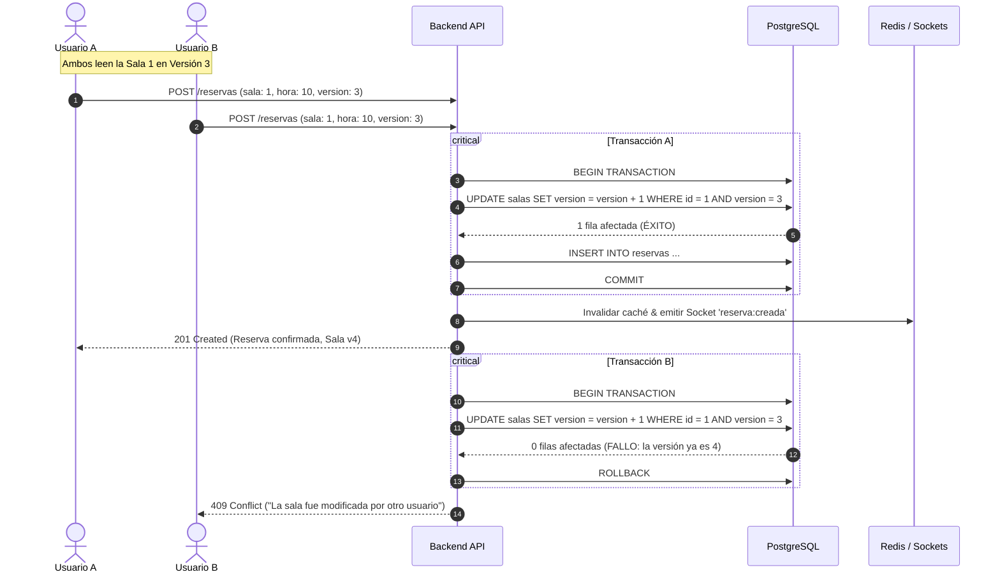

# ⚡ Control de Concurrencia Optimista

Uno de los requerimientos nucleares del sistema (**RF-04**) es el control de concurrencia optimista para evitar sobre-reservas (*double-booking*) sin recurrir a bloqueos pesados a nivel de tabla o fila que degraden el rendimiento.

---

## 🔍 ¿Por qué Bloqueo Optimista?

En sistemas de reservas con alta concurrencia, el bloqueo pesimista (`SELECT ... FOR UPDATE`) puede generar contención excesiva y tiempos de espera altos.

El **bloqueo optimista** asume que la mayoría de las transacciones no colisionarán entre sí. Por ello:
1. Cada registro de sala contiene una columna de versión (`version INT NOT NULL DEFAULT 1`).
2. El cliente consulta la disponibilidad y recibe el número de versión actual de la sala.
3. Al intentar reservar, el cliente envía la versión que leyó (`version_esperada`).
4. La base de datos solo confirma la actualización si la versión actual sigue siendo igual a la versión esperada. Si otra transacción ya modificó la sala, la versión habrá cambiado y la operación fallará limpiamente.

---

## 🔄 Flujo de Ejecución del Backend



---

## 🛡️ Doble Red de Seguridad en Base de Datos

Además de la verificación por versión a nivel de aplicación dentro de la transacción, PostgreSQL cuenta con un **índice único parcial**:

```sql
CREATE UNIQUE INDEX idx_reserva_unica_activa 
ON reservas (sala_id, fecha, hora_inicio) 
WHERE estado = 'CONFIRMADA';
```

Esto garantiza matemáticamente que:
1. Nunca podrán existir dos reservas con estado `CONFIRMADA` en la misma sala, fecha y hora de inicio.
2. Si por cualquier motivo ocurriera una condición de carrera imprevista, la base de datos lanzará un error de violación de restricción única (`23505`), el backend ejecutará `ROLLBACK` y retornará un error amigable al cliente.
