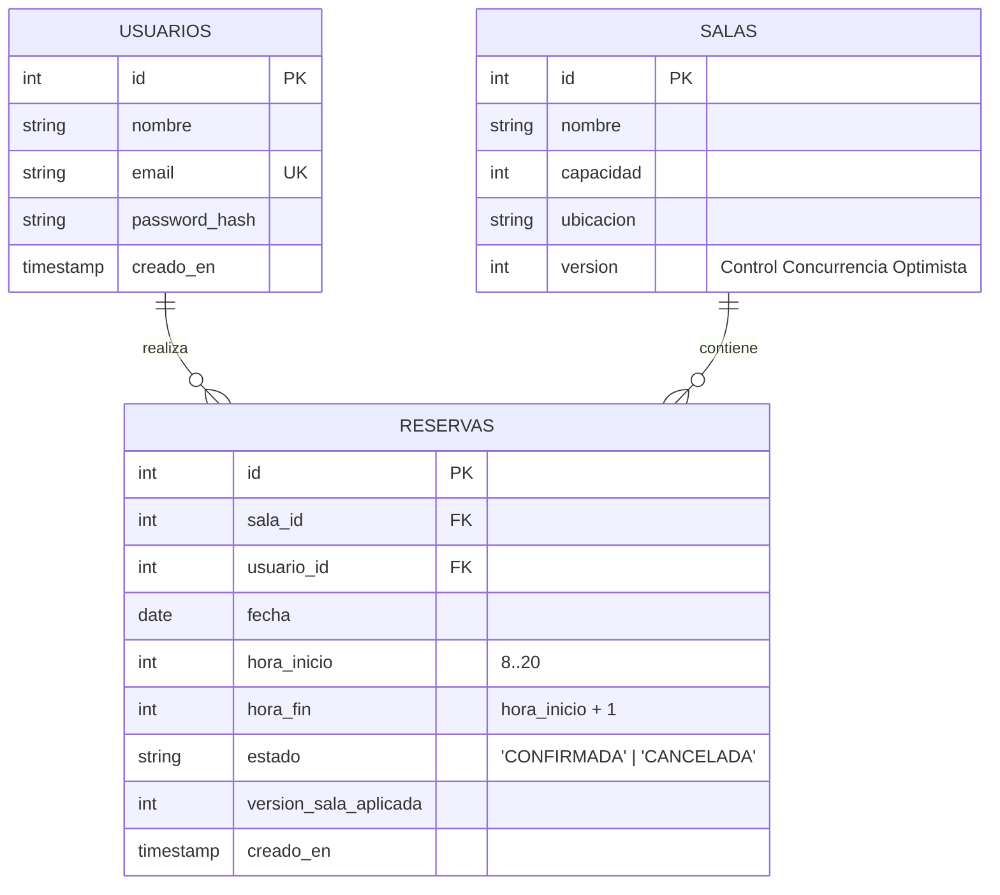

# 🗄️ Modelo de Base de Datos (SQL Puro)

La persistencia del proyecto se construyó deliberadamente **sin ORMs** (como Prisma, TypeORM o Drizzle). Toda interacción con PostgreSQL se ejecuta mediante el driver nativo `pg` utilizando SQL nativo y transacciones explícitas (`BEGIN`, `COMMIT`, `ROLLBACK`).

---

## 📐 Diagrama Entidad-Relación



---

## 📜 Script DDL de Creación (`init.sql`)

```sql
DROP TABLE IF EXISTS reservas CASCADE;
DROP TABLE IF EXISTS salas CASCADE;
DROP TABLE IF EXISTS usuarios CASCADE;

-- Tabla de Usuarios (RF-01)
CREATE TABLE usuarios (
    id SERIAL PRIMARY KEY,
    nombre VARCHAR(100) NOT NULL,
    email VARCHAR(150) UNIQUE NOT NULL,
    password_hash TEXT NOT NULL,
    creado_en TIMESTAMP DEFAULT CURRENT_TIMESTAMP
);

-- Tabla de Salas / Espacios de Estudio (RF-04)
CREATE TABLE salas (
    id SERIAL PRIMARY KEY,
    nombre VARCHAR(100) NOT NULL,
    capacidad INT NOT NULL,
    ubicacion VARCHAR(100),
    version INT NOT NULL DEFAULT 1 -- Incrementado en cada reserva/cancelación
);

-- Tabla de Reservas (RF-03, RF-04, RF-05, RF-07)
CREATE TABLE reservas (
    id SERIAL PRIMARY KEY,
    sala_id INT NOT NULL REFERENCES salas(id) ON DELETE CASCADE,
    usuario_id INT NOT NULL REFERENCES usuarios(id) ON DELETE CASCADE,
    fecha DATE NOT NULL,
    hora_inicio INT NOT NULL CHECK (hora_inicio >= 8 AND hora_inicio <= 20),
    hora_fin INT NOT NULL CHECK (hora_fin = hora_inicio + 1),
    estado VARCHAR(20) NOT NULL DEFAULT 'CONFIRMADA',
    version_sala_aplicada INT NOT NULL,
    creado_en TIMESTAMP DEFAULT CURRENT_TIMESTAMP
);

-- Índice Único Parcial: Garantía física anti-solapamiento
CREATE UNIQUE INDEX idx_reserva_unica_activa 
ON reservas (sala_id, fecha, hora_inicio) 
WHERE estado = 'CONFIRMADA';
```

---

## 💡 Aspectos Técnicos Destacados

* **Regla de Bloques de 1 Hora:** Validada a nivel de tabla con la cláusula `CHECK (hora_fin = hora_inicio + 1)`.
* **Rango Horario:** Restringido entre 8:00 y 20:00 mediante `CHECK (hora_inicio >= 8 AND hora_inicio <= 20)`.
* **Soft-Cancel:** Las cancelaciones no eliminan la fila físicamente, sino que actualizan el `estado = 'CANCELADA'`, lo que libera el índice parcial `idx_reserva_unica_activa` permitiendo que otro usuario reserve el mismo bloque.
