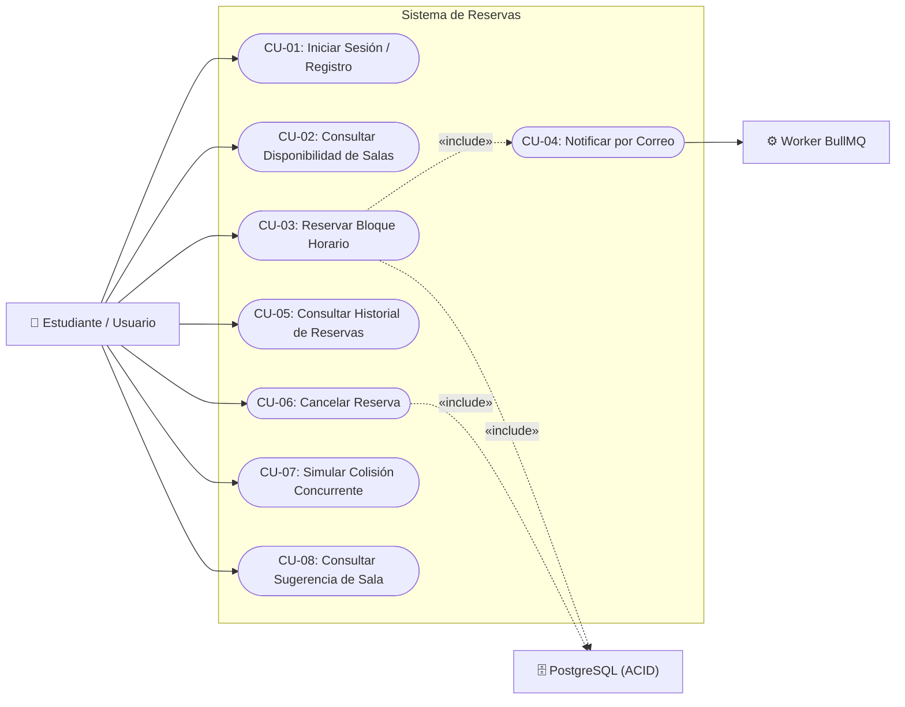

# 🎯 Modelo de Casos de Uso

El diagrama de casos de uso modela los requisitos funcionales del sistema, identificando a los actores y sus interacciones con las distintas operaciones del software.

---

## 👥 Actores del Sistema

* **Estudiante / Usuario:** Actor principal que interactúa con la interfaz para consultar disponibilidad, reservar espacios, cancelar reservas y simular escenarios.
* **Worker de Notificaciones (BullMQ):** Actor del sistema que procesa en segundo plano el envío inmediato de correos y la programación de recordatorios diferidos.
* **Motor de Base de Datos (PostgreSQL):** Actor del sistema que garantiza la integridad transaccional ACID y la resolución del bloqueo optimista.

---

## 📊 Diagrama de Casos de Uso (Mermaid)

---

## 📋 Especificación de Casos de Uso Principales

### CU-03: Reservar Bloque Horario (RF-03, RF-04)
* **Actor Principal:** Estudiante / Usuario.
* **Precondiciones:** El usuario debe estar autenticado con token JWT válido y seleccionar una sala, fecha y hora disponible.
* **Flujo Principal:**
  1. El usuario selecciona un bloque y presiona "Reservar".
  2. El frontend envía `sala_id`, `fecha`, `hora_inicio` y la `version_esperada` de la sala.
  3. El backend inicia una transacción SQL con `BEGIN`.
  4. Se ejecuta el incremento condicional de versión: `UPDATE salas SET version = version + 1 WHERE id = $1 AND version = $2`.
  5. Si la fila es actualizada (1 fila afectada), se inserta la reserva con estado `CONFIRMADA`.
  6. Se confirma la transacción con `COMMIT`.
  7. Se emite evento `reserva:creada` a través de Socket.io y se encola la notificación en BullMQ.
  8. El cliente recibe HTTP `201 Created`.
* **Flujo Alternativo (Colisión / Concurrencia):**
  * Si la versión esperada ya fue alterada por otra transacción previa, `UPDATE` afecta 0 filas.
  * El backend revierte la transacción con `ROLLBACK` y retorna HTTP `409 Conflict`.

### CU-06: Cancelar Reserva (RF-05)
* **Actor Principal:** Estudiante / Usuario.
* **Regla de Negocio:** La cancelación solo es admitida si faltan **al menos 2 horas** para el inicio del bloque reservado.
* **Efecto:** Actualiza el estado a `CANCELADA`, incrementa la versión de la sala, invalida la caché en Redis y notifica vía WebSockets.
