# 🗺️ Modelo de Navegación (Flujo de Pantallas)

El modelo de navegación representa la arquitectura de información real de la aplicación Next.js y el flujo de navegación del usuario.

El sistema no requiere autenticación previa para explorar el portal: el usuario **ingresa directamente en la página de inicio (Home / Landing Page)** y desde allí navega libremente hacia las distintas secciones mediante el menú principal o la barra de navegación persistente (**Navbar**).

---

## 🧭 Diagrama de Navegación (Mermaid)

```mermaid
flowchart TD
    Home["🏠 Home / Landing Page (/)\n(Portal Arcade Retro con Menú Principal)"]

    %% Rutas directas desde el Menú Principal / Navbar
    Home -->|RESERVAR LAB| Reservas["📅 Disponibilidad & Reservas (/reservas)"]
    Home -->|MIS RESERVAS| MisReservas["📋 Historial de Reservas (/mis-reservas)"]
    Home -->|ACCESO / LOGIN| Login["🔐 Acceso / Login (/login)"]
    Home -->|PANEL ADMIN| Admin["⚙️ Panel de Administrador (/admin)"]

    %% Flujo en /reservas
    subgraph ModuloReservas ["Página de Disponibilidad (/reservas)"]
        Sugerencia["💡 Sugerir Sala\n(Algoritmo heurístico por hora y aforo)"]
        Calendario["🗓️ Grilla Horaria\n(Matriz de Salas y Bloques 8:00 a 20:00)"]
        ModalConfirmar["📝 Modal de Confirmación\n(Muestra sala, bloque y versión esperada)"]

        Calendario -->|Clic en bloque disponible| ModalConfirmar
        Sugerencia -->|Aceptar recomendación| ModalConfirmar
        ModalConfirmar -->|HTTP 201 Created| Calendario
    end
    Reservas --> ModuloReservas

    %% Flujo en /mis-reservas
    subgraph ModuloMisReservas ["Página de Mis Reservas (/mis-reservas)"]
        ListaReservas["📋 Historial de Reservas del Usuario"]
        BotonCancelar["❌ Cancelar Reserva\n(Validación de regla >= 2 horas)"]

        ListaReservas --> BotonCancelar
        BotonCancelar -->|Confirmado| ListaReservas
    end
    MisReservas --> ModuloMisReservas

    %% Flujo en /login
    subgraph ModuloAuth ["Página de Acceso (/login)"]
        FormAuth["🔑 Formulario Login / Registro"]
        QuickUsers["⚡ Acceso Rápido para Pruebas\n(Alumno A, Alumno B, Admin)"]

        FormAuth -->|Autenticación Exitosa| Reservas
        QuickUsers -->|Rol Alumno| Reservas
        QuickUsers -->|Rol Administrador| Admin
    end
    Login --> ModuloAuth

    %% Flujo en /admin
    subgraph ModuloAdmin ["Consola de Administración (/admin)"]
        Auditoria["📊 Auditoría Global de Reservas"]
        CrearSalaModal["➕ Modal Nueva Sala"]

        Auditoria --> CrearSalaModal
    end
    Admin --> ModuloAdmin

    %% Componente Global Navbar
    subgraph GlobalNav ["Elementos Transversales (Navbar en todas las páginas)"]
        Simulador["⚡ Simulador de Concurrencia\n(Modal accesible desde cualquier ruta)"]
        LogoMDW["Logo MDW ➔ Retorno a Home (/)"]
    end

    Reservas -.-> Simulador
    MisReservas -.-> Simulador
    Admin -.-> Simulador
    Home -.-> Simulador
```

---

## 📱 Descripción de Rutas y Pantallas

| Ruta | Nombre de Pantalla | Tipo de Acceso | Descripción y Operaciones |
| :--- | :--- | :--- | :--- |
| **`/`** | **Home / Landing Page** | Público | Pantalla inicial del sistema con estética Arcade Neobrutalista. Permite seleccionar con teclado o ratón cualquiera de las opciones del menú. |
| **`/reservas`** | **Disponibilidad & Reservas** | Público / Alumno | Vista principal de la grilla horaria (8:00 a 20:00). Incluye el calculador heurístico de sala óptima y el modal de reserva con control de versiones. |
| **`/mis-reservas`** | **Mis Reservas** | Autenticado | Historial personal de bloques reservados, indicando estado (`CONFIRMADA`, `CANCELADA`) y botón para cancelar con validación de al menos 2 horas (`>= 2h`). |
| **`/login`** | **Acceso & Autenticación** | Público | Formulario de inicio de sesión, registro y botones de acceso rápido para demostración (Alumno A, Alumno B, Administrador). |
| **`/admin`** | **Panel de Administrador** | Rol Administrador | Consola de auditoría global de reservas, creación de nuevos espacios/laboratorios y administración de salas. |
| **Modal Global** | **Simulador de Concurrencia** | Accesible en Navbar | Modal emergente disponible en toda la aplicación para disparar dos peticiones simultáneas y evidenciar el bloqueo optimista (`201` vs `409`). |
