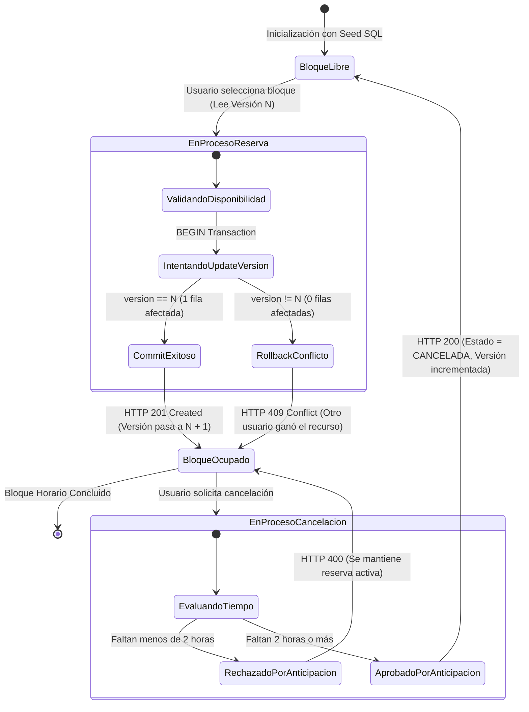
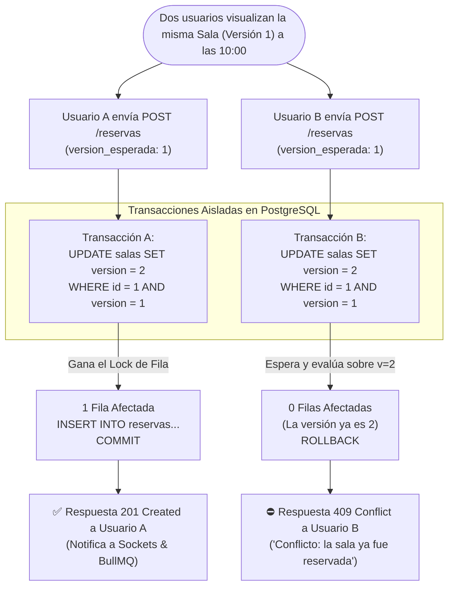

# 🔄 Modelo de Interacción y Estados

El modelo de interacción describe cómo el usuario interactúa con el sistema para mutar el estado de los recursos (salas y bloques horarios), y cómo reacciona el backend ante condiciones normales y colisiones.

---

## 🚦 Máquina de Estados de un Bloque Horario

---

## ⚡ Flujo de Interacción: Concurrencia Simultánea

---

## 📌 Garantías de la Interacción

1. **Aislamiento e Idempotencia:** Ningún bloque puede quedar en un estado inconsistente o parcialmente reservado.
2. **Retroalimentación Inmediata:** Si un usuario pierde la contienda de reserva, la UI muestra inmediatamente una alerta amigable explicándole que el recurso fue tomado por otro usuario y refresca los datos.
