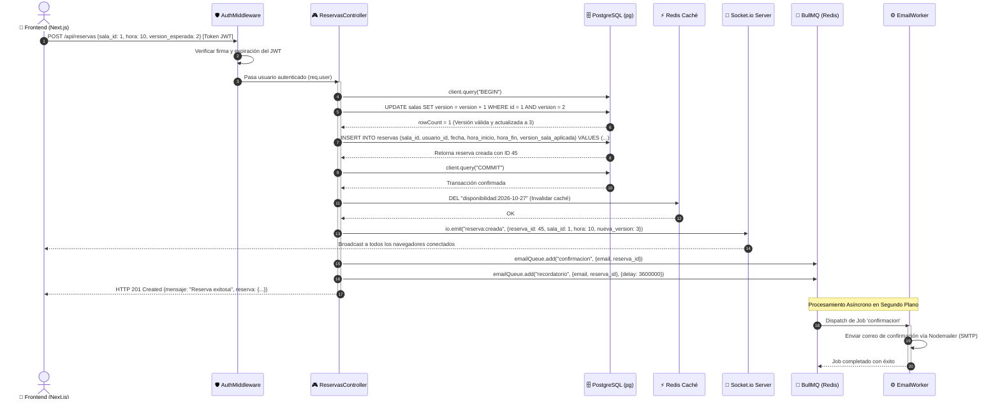

# ⏱️ Modelo de Secuencia del Sistema

El diagrama de secuencia detalla el orden cronológico de los mensajes e intercambios de datos entre los distintos subsistemas al ejecutar una reserva exitosa.

---

## 🛰️ Diagrama de Secuencia Completo (Mermaid)

---

## 🔍 Análisis de Tiempos y Rendimiento

1. **Ruta Crítica Minimizada (Pasos 1 al 10):** La transacción ACID en PostgreSQL solo abarca la actualización del contador de versión y la inserción de la reserva. Toma comúnmente menos de **5 ms**.
2. **Tareas Asíncronas Fuera de la Transacción (Pasos 11 al 16):** La invalidación de caché, el broadcast por WebSockets y el encolado en BullMQ ocurren después de que la transacción fue confirmada con `COMMIT`, evitando retener conexiones de base de datos innecesariamente.
3. **Desacoplamiento del Correo (Pasos 17 al 19):** El usuario no espera los 1 a 2 segundos que tarda el servidor SMTP en enviar el correo; la API responde inmediatamente con HTTP `201`.
