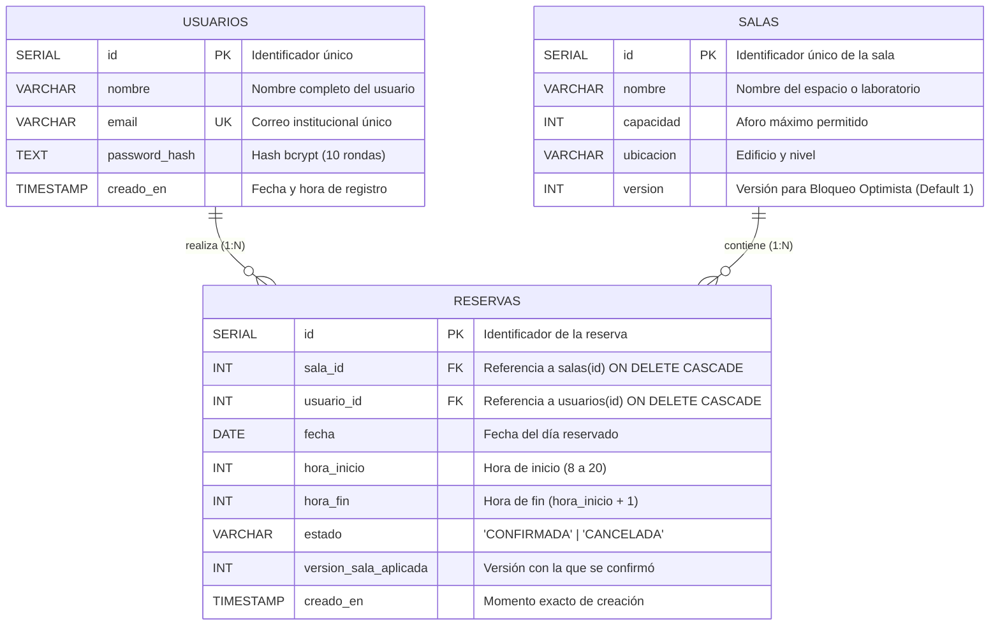

# 🗃️ Modelo Entidad - Relación (E-R)

El modelo Entidad-Relación define la estructura de datos relacional implementada en PostgreSQL puro sin intermediación de ORMs.

---

## 📊 Diagrama Entidad - Relación (Mermaid)

---

## 🔑 Restricciones de Integridad y Llaves

| Tabla | Restricción / Índice | Tipo | Justificación Técnica |
| :--- | :--- | :--- | :--- |
| `usuarios` | `PRIMARY KEY (id)` | Llave Primaria | Identificador secuencial de usuario. |
| `usuarios` | `UNIQUE (email)` | Restricción Única | Evita cuentas duplicadas por correo. |
| `salas` | `PRIMARY KEY (id)` | Llave Primaria | Identificador único del recurso físico. |
| `salas` | `version INT NOT NULL DEFAULT 1` | Columna de Control | Base del algoritmo de concurrencia optimista. |
| `reservas` | `FOREIGN KEY (sala_id)` | Integridad Referencial | Enlaza la reserva a una sala existente (`CASCADE`). |
| `reservas` | `FOREIGN KEY (usuario_id)` | Integridad Referencial | Enlaza la reserva al usuario titular (`CASCADE`). |
| `reservas` | `CHECK (hora_inicio >= 8 AND <= 20)` | Restricción Check | Delimita el horario de atención permitido. |
| `reservas` | `CHECK (hora_fin = hora_inicio + 1)` | Restricción Check | Fuerza duración de exactamente 1 bloque horario. |
| `reservas` | `idx_reserva_unica_activa` | Índice Único Parcial | `WHERE estado = 'CONFIRMADA'`: Evita físicamente solapamientos sin bloquear reservas canceladas. |
